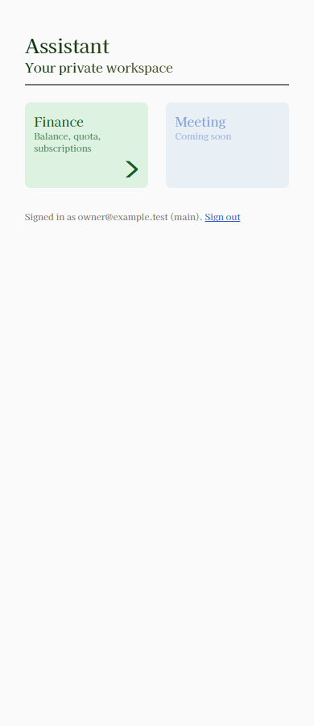
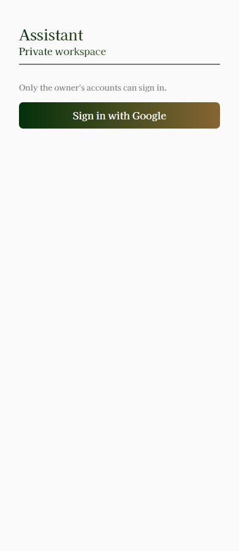
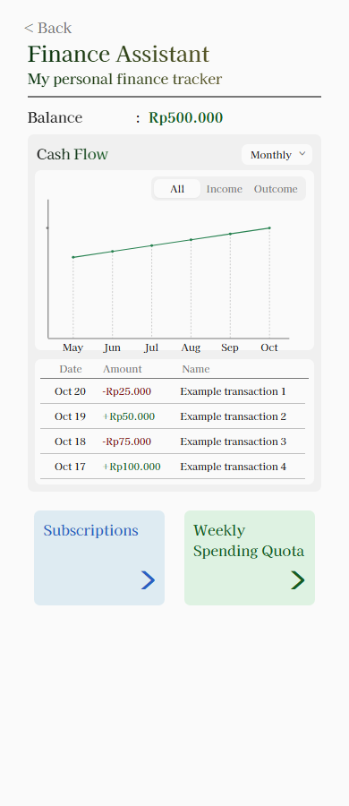
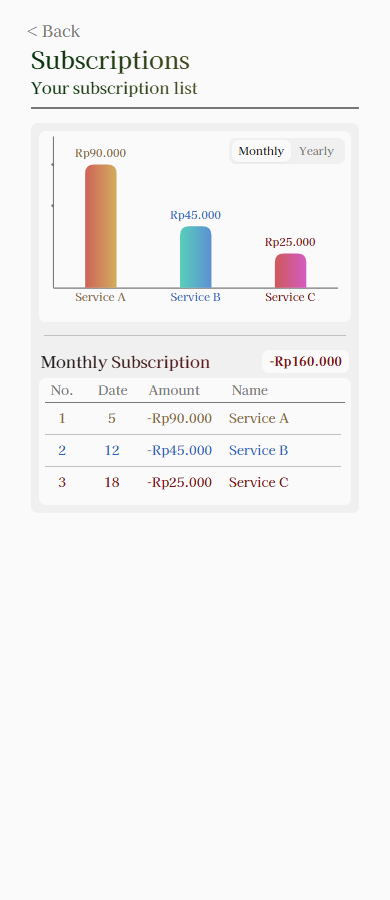
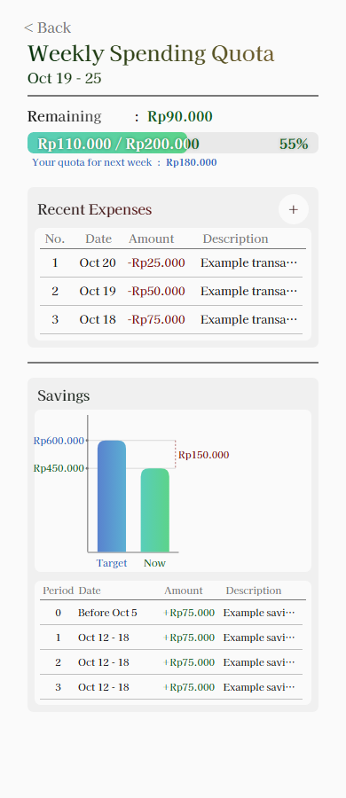
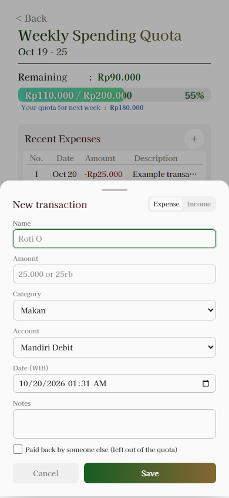

# Assistant UI/UX audit

Reviewed on 20 Oct 2026. Code baseline: `bda2a62`. Scope: the private assistant web app
and its five implemented routes. This delivery documents the current design and a
proposed improvement plan; it does not change runtime UI, backend rules, or dependencies.

Use the [design system](assistant-design-system.md) to build matching pages and the
[motion specification](assistant-motion.md) to implement feedback and animation.

## 1. Review method and limits

The review combines source inspection with local Chromium rendering. API requests in a
fresh isolated browser context were intercepted and fulfilled with synthetic data. A
synthetic local session cookie let the local proxy render private screens; no production
session or private API response was used. Non-GET fixture requests were rejected. No
transactions, authentication records, Notion pages, or spreadsheet cells were changed.

The in-app browser connection failed before navigation because of a runtime configuration
error. The visual review used a separate local headless browser against the already
running app on port 3100. The examples below are screenshots of the implemented app,
not Figma mockups. The development indicator was hidden for documentation captures.

Checks completed:

- All five routes rendered at 320, 390, 480, and 1440 CSS px, with local screenshots and
  document/column width measurements for each of the 20 combinations.
- Expense and Income variants of the transaction sheet inspected at 390 px; Escape
  dismissal checked, including the resulting focused element.
- Successful empty results inspected for Finance and Subscriptions; simulated API
  failures inspected for Finance, Subscriptions, and Quota.
- Source inspected for loading/reload, form validation, duplicate submission, chart
  geometry, formatting, auth redirects, semantics, and existing motion.
- Selected foreground/background pairs calculated from CSS colors using relative
  luminance; these are token checks, not a full rendered contrast audit.

Not verified here: real OAuth, real save/duplicate/sync requests, slow-network timing,
all quota threshold states in the browser, long/dense subscription fixtures, real mobile
devices, software keyboards, browser zoom, a full keyboard traversal, screen readers,
or animation performance. Those are implementation acceptance checks, not completed tests.

## 2. Information architecture and user journeys

| Route / screen | Main job | Content order | Data and actions |
|---|---|---|---|
| `/` / `Hub` | Choose an assistant | Header → two module tiles → account footer | `/auth/me`; Finance link; disabled Meeting tile; sign out |
| `/login` / `Login` | Enter private workspace | Header → access explanation → auth error if any → Google action | `/auth/config`; Google redirect; development-only login when configured |
| `/finance` / `FinanceDashboard` | Read balance and cash movement | Header/Back → Balance → Cash Flow controls/chart → transactions → module tiles | `/finance/summary`, `/finance/cashflow?granularity=…`, `/finance/transactions?kind=…&limit=100` |
| `/finance/subscriptions` / `SubscriptionsScreen` | Compare recurring charges | Header/Back → chart/toggle → divider → cycle heading/total → subscription rows | `/finance/subscriptions`; Monthly/Yearly changes chart, total, heading, palette, and table locally |
| `/finance/quota` / `QuotaScreen` | Check spending room and add an expense | Header/period → Remaining → quota bar → next-week estimate → recent expenses/Add → divider → Savings chart/table | `/finance/quota`, `/finance/options`; Add opens sheet; accepted save reloads quota |

The shortest action journey is Hub → Finance → Weekly Spending Quota → Add → Save.
Read-only journeys reach Subscriptions and Quota in two navigations from Hub.
Each finance page has a clear parent Back link. There is no global sidebar, bottom tab
bar, search, or working Meeting route. API-supported transaction edit/delete and paid
subscription actions are future UI work, as recorded in the roadmap.

## 3. What is already coherent

The interface has a recognizable personal style: consistent serif typography, gradient
titles, restrained page backgrounds, pastel navigation tiles, rounded chart bars, and
colored financial values. The main column, header, grouped panels, figures, and table
component already make route-to-route consistency practical.

Screen hierarchy is compact. Balance/Remaining appears before detail; related charts and
tables share a panel. Currency helpers, WIB date handling, explicit signs, estimate
markers, and the subscription chart/table color relationship improve interpretation.
The quota bar intentionally handles fill overflow separately from the true percentage.

These patterns are worth keeping. The main gaps concern state clarity, access, and
component behavior rather than the need for a different visual theme.

## 4. Current visual references

All amounts, service names, transaction rows, and the displayed email in these captures
are synthetic fixtures. Field placeholders/defaults are the app's existing copy. Standard
mobile captures use a 390 × 900 viewport; the sheet uses 390 × 844. Full-page capture may
extend beyond viewport height. These PNGs are safe documentation fixtures, separate from
the ignored Figma exports.

| Hub | Login |
|---|---|
|  |  |

| Finance | Subscriptions |
|---|---|
|  |  |

| Weekly quota | Transaction sheet |
|---|---|
|  |  |

Additional references: [320 px Finance](assets/assistant/320-finance.png) shows the
narrow-width tile issue below; [1440 px Hub](assets/assistant/1440-hub.png) confirms
that desktop retains the centered 480 px column.

## 5. Findings and recommendations

Priority meanings: **P0** is a prerequisite for trustworthy/accessibly operated UI;
**P1** improves everyday usability and consistency; **P2** is optional refinement.
These are UI implementation priorities, not production incident severity.

### P0 — Data lifecycle and failure clarity

`useApi.ts` initializes `loading` once. Reload and path changes retain data but do not
set loading/refreshing again. The effect's `alive` guard prevents obsolete effects from
replacing state, but the selected filter can change while the old dataset stays visible
without explanation. A failed new filter can leave previous results under the new label.

Finance does not display `cashflow.error`; initial chart failures can look like an empty
ledger. Subscriptions displays an error above the panel but still defaults to empty items
and a `-Rp0` total, which looks like a successful result. Quota's first load mounts most
of the page only after data arrives, so its footprint changes substantially. None of these
data sections has a user-visible retry control.

Implement initial-loading versus refreshing state per request key, retained/stale-data
copy, and retry. Show empty only after a successful empty response. Use the region-level
skeleton and state matrix in the motion guide; a route-level loading screen cannot by
itself cover these client fetches.

### P0 — Toggle semantics and pointer targets

`Toggle` uses tab roles without tab panels, roving focus, or arrow navigation. These
controls mostly filter data or choose form type. Choose native radio/grouped pressed
button semantics for filters, or complete the [APG tabs pattern](https://www.w3.org/WAI/ARIA/apg/patterns/tabs/)
when they genuinely switch associated panels. Keep the current visual track/pill style.

Measured toggle heights were 20.11 px at 320, 21.14 px at 390, and 22.48 px at 480/1440.
Adjacent pills are compact, making touch selection harder. The Add button was 34 × 34 px.
The product recommendation is a 44 CSS px pointer target for primary controls, independent
of scaled spacing. WCAG 2.2 AA's [Target Size (Minimum)](https://www.w3.org/WAI/WCAG22/Understanding/target-size-minimum.html)
uses 24 × 24 CSS px with exceptions, including spacing; these measurements alone do not
establish failure for every target. Audit spacing and exceptions before making that claim.

### P0 — Modal focus and outstanding saves

`AddTransactionSheet` has a named dialog, initial input focus, Escape, and backdrop close.
It does not contain Tab focus, make the background inert, lock page scrolling, or restore
focus. In the local Escape check, focus ended on `body`, not the Add button. The
[APG modal pattern](https://www.w3.org/WAI/ARIA/apg/patterns/dialog-modal/)
requires contained focus and generally returns focus to the invoking control.

Save disables itself while busy, but Cancel, Escape, backdrop dismissal, and the duplicate
override action do not share a busy guard. Dismissal can hide the outcome of an in-flight
write. Define a consistent pending-save policy, prevent repeat submission across all save
paths, and restore focus on close. Add field `aria-invalid`/`aria-describedby` wiring,
first-error focus, and a concise result announcement. Preserve user input on API errors.

### P0 — Text contrast

Selected token calculations, rounded here for readability:

| Foreground / background | Ratio | Where it matters |
|---|---:|---|
| Muted `#787878` / page `#FAFAFA` | 4.23:1 | Small helper text and Back |
| Muted `#787878` / panel `#F0F0F0` | 3.87:1 | Small inactive toggle/header text |
| White / quota green endpoint `#59CEBA` | 1.92:1 | Amount text over green fill |
| White / quota green endpoint `#5CD38A` | 1.89:1 | Amount text over green fill |
| Green `#165D23` / track `#E9E9E9` | 6.59:1 | Colored amount over unfilled track |

Normal text generally needs 4.5:1; qualifying large text needs 3:1 under
[WCAG Contrast (Minimum)](https://www.w3.org/WAI/WCAG22/Understanding/contrast-minimum.html).
Small muted text falls below the normal-text threshold on these surfaces. The white
quota label needs a stronger treatment; its subtle text glow is not a verified solution.
Darken the semantic muted text token or introduce a tested text-specific token, and
evaluate darker quota text or a suitable label surface. Check the whole gradient behind
actual text, all progress levels, placeholders, and focus states before finalizing colors.
The palette can retain its identity while improving these pairs.

### P1 — Fixed tile height at narrow widths

At 320 px the Weekly Spending Quota navigation label wraps to three lines while its
tile remains `h-292` (about 86.52 CSS px). The chevron visibly extends below the mint
tile. The document still has no horizontal overflow: that check alone does not establish
that components fit internally.

Use a shared tile primitive with a minimum height, intrinsic content sizing, and enough
space for both label and chevron. Keep the existing two-column visual treatment where
it fits. Verify text zoom and long module names before choosing a narrow-width fallback.

### P1 — Table semantics and full text access

`DataTable` draws grids with `div`/`span`; assistive technology does not get native row
and column-header relationships. Truncation helps density but hides expense descriptions
and savings notes. A native `title` on some spans is insufficient for touch access.

Preserve the visual geometry while adding native table markup where practical, or correct
table roles and header associations after testing. Offer a reachable full-text/detail
action for truncated values. Make internal scrolling discoverable and keyboard-operable.
Do not introduce hover styling that implies inert rows have an action.

### P1 — Chart interpretation and identity

Subscription bars impose a 40-unit minimum height, including a zero price. Savings also
clamps negative Now to a positive-looking minimum bar. The values remain printed, but
the shapes can tell a different story. Dense subscription names/prices can collide.
Subscription colors follow array position rather than stable entity identity.

Specify zero/negative handling, dense-label behavior, and stable ID-to-color mapping
before animating updates. Cash flow and subscription SVG labels are generic accessible
names; provide a concise summary and an accessible value list/table appropriate to each
chart. Current visible tables are useful but first need semantic relationships, and the
transaction table is not an equivalent period summary for the cash flow chart.

### P1 — Feedback and reusable controls

Buttons and navigation tiles repeat inline class strings. Most have no consistent hover,
press, or shared focus treatment. Group by suppresses the default outline without adding
a visible focus ring. Save has a busy label; sign-in/sign-out have no equivalent lifecycle
feedback, and sign-out currently swallows API errors before redirecting. Auth config errors
also lack an explicit presentation state.

Extract Button, NavigationTile, and a corrected modal/form layer as repeated behavior
requires them. Add visible focus independent of hover, localized loading/error feedback,
and truthful save/sync messaging. A saved note should be announced without moving focus.
Current quota copy promises a sync delay; a future sync-status UI should distinguish
accepted locally, pending externally, and failed sync rather than infer completion.

### P2 — Motion and richer selection

The current implementation contains a toggle `transition-colors`, Back/toggle hover
color, and form focus styling. It has no skeleton, chart animation, sheet presence
transition, custom dropdown popup, route reveal, or reduced-motion policy.

Apply the [motion specification](assistant-motion.md) after the prerequisites above:
short button/tile feedback, matching skeletons, chart entrance/update, synchronized quota
fill/clipping, sheet slide/fade, and an accessible custom select. Optional route entrances
should remain subtle and should not multiply with every nested card's animation.

## 6. Roadmap and verification handoff

Implement P0 state/focus/contrast foundations first, then P1 loading and repeated controls,
then chart/sheet motion, then richer dropdowns or route effects. Keep these as logical
implementation changes so each can be reviewed with before/after behavior and focused
checks. None is marked done merely because it appears in this documentation.

For a new page, start from the design-system recipe and closest existing screen. For a
shared component change, update its contract here and in the design guide. For motion,
record the trigger, duration, property, cancellation behavior, and reduced-motion result.

Use synthetic fixtures in future public documentation. To refresh visual references,
run the web app, intercept `/api/v1/**` in an isolated local browser context with typed
fixture responses, reject writes, wait for fonts and settled data, and capture the same
route/viewport combinations. Include empty/error cases privately for review. Do not copy
production responses, personal account details, or raw Figma exports into tracked assets.

This audit is not a WCAG conformance assessment. Reflow/zoom checks should follow the
[WCAG reflow guidance](https://www.w3.org/WAI/WCAG22/Understanding/reflow.html), and new
keyboard/modal/dropdown work needs manual assistive-technology verification in addition
to automated checks.
