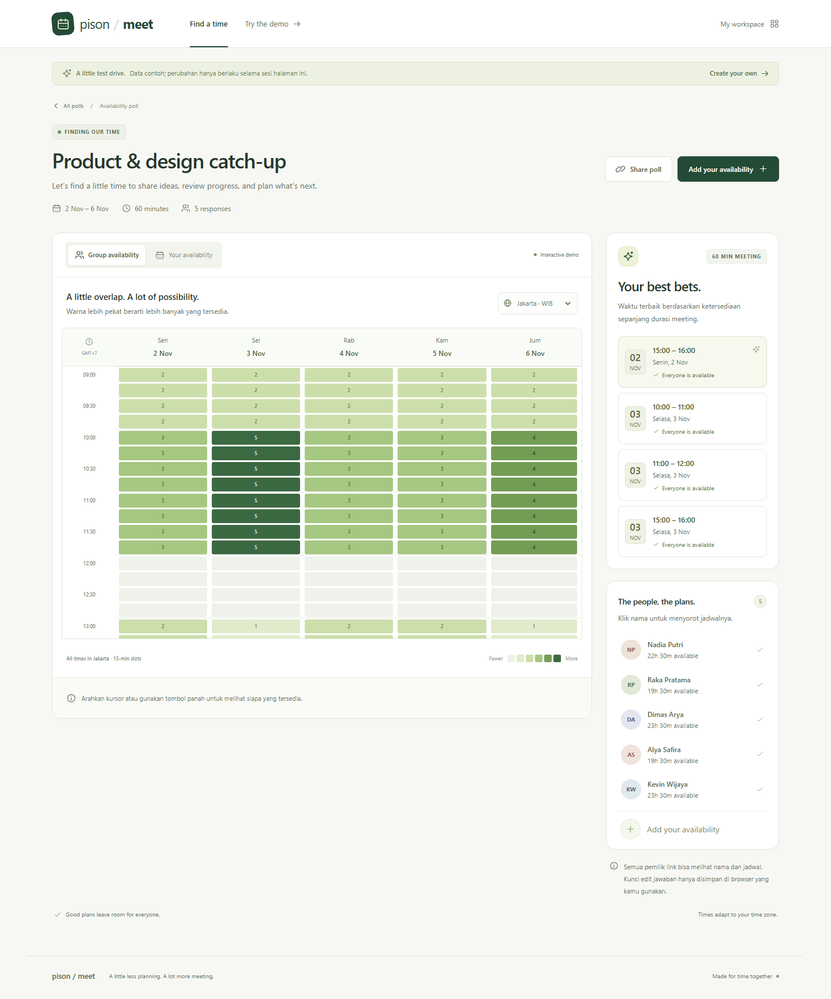
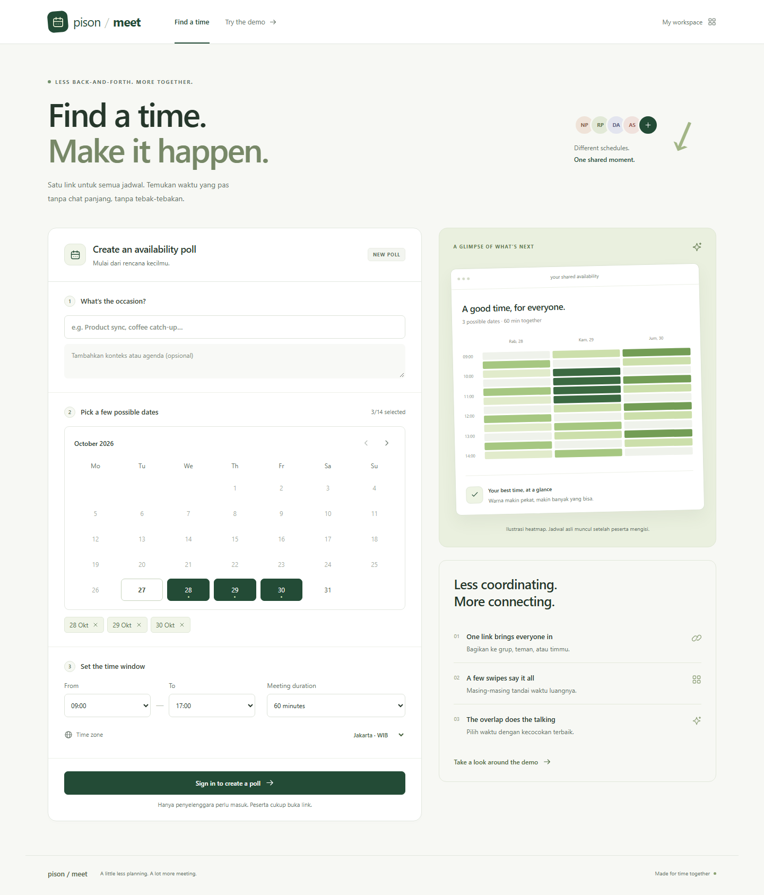
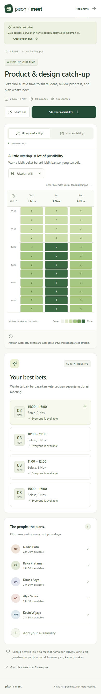
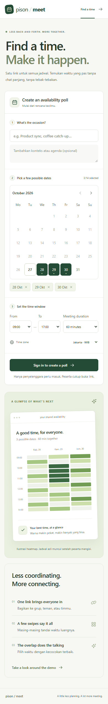

# Meeting UI

Implemented 27 Oct 2026 for `/meeting/availability`. Product behavior, reference analysis,
API contracts, and verification are in [Meeting availability](../docs/meeting.md).

Meeting is a separate surface from the private Assistant. Its scoped styles deliberately
use a wide sans-serif layout to support a modern scheduling interface. Existing
Assistant screens keep their narrow serif layout.

## Visual language

- Canvas `#f7f8f4`, white cards, quiet `#e2e7df` borders.
- Forest actions `#234b36`; six heatmap levels from `#eff2eb` to `#3b6941`.
- Calendar mark, lime accents, compact badges, and participant initials.
- Maximum 1,344 px shell including gutters. Creation uses form/preview columns; events
  use calendar/results columns. Main layouts stack at 820 px, result cards at 540 px.
- System sans-serif, a larger creation headline, compact event heading. Explanatory
  copy uses Indonesian; short controls and headings use English.

The form preview is explicitly illustrative. The demo has five synthetic participants
and a visible banner. Real polls start empty. Counts and recommendations use saved
responses; unsaved selections remain local drafts.

## Interaction states

The flow is create → share → mark availability → compare → confirm. Personal/group
views use pressed button groups. An unsaved dot and save footer identify the draft.
Loading, empty, missing, retry, offline, stale, saved, confirmed, and reopened states
have specific copy and actions.

Zone changes preserve the actual selected instants. A recommendation highlights its
entire duration and scrolls the calendar to its start. Clicking a participant filters
only the group calendar; recommendations still represent everyone. Confirmation
makes partial attendance explicit.

Motion is brief and optional. Reduced motion makes the modal appear directly and
recommendation scrolling immediate. Keyboard navigation and focus never wait for it.

## Synthetic references

Captures use the demo and public creation form. They contain no private finance,
production sessions, or real participant data.

| Desktop poll | Desktop creation |
|---|---|
|  |  |

| Mobile poll | Mobile creation |
|---|---|
|  |  |
