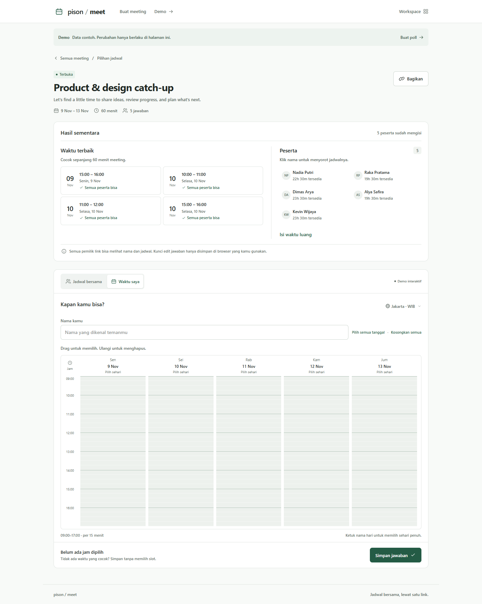
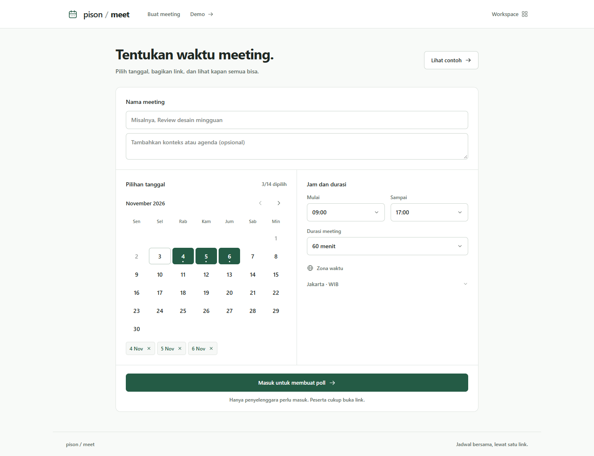
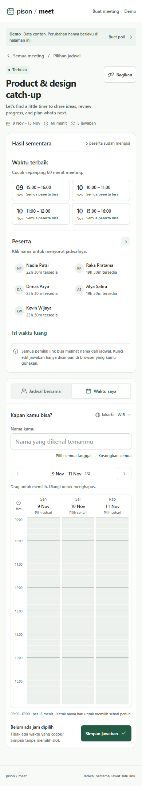
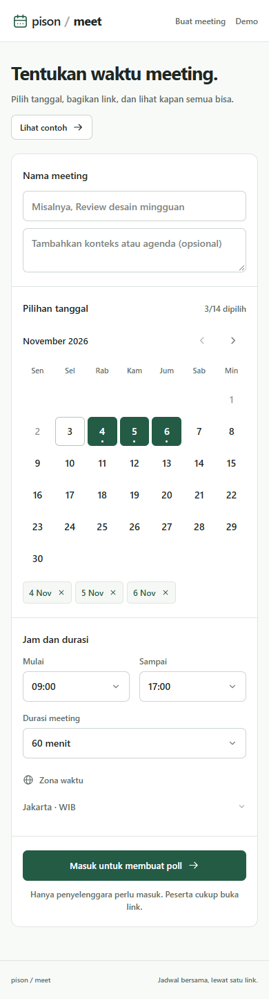

# Meeting UI

Updated 3 Nov 2026 for `/meeting/availability`. API contracts and persistence remain
in [Meeting availability](../docs/meeting.md).

## Layout

Meeting uses a separate system-sans surface from the private Assistant. The shell is
1,184 px including gutters, with neutral off-white backgrounds, white panels, subtle
borders, and green primary actions. Headings and controls use direct Indonesian copy.
There are no marketing slogans, decorative mock calendars, or synthetic avatars on
the creation page.

Creation uses one form: title and optional agenda above the month calendar and time
settings. Those settings sit beside the calendar on desktop and below it on phones.
Invitations put interim recommendations and participants above the availability matrix.
The summary has two sections side by side on desktop and stacks them on phones.
Recommendation cards use two columns. Participant names form a compact wrapping list;
more than six names have a show-more control. Inputs use 16 px text on phones.

## Compact availability

- Each day is one column of 15-minute cells, following the When2meet matrix model.
- Desktop shows up to seven day columns; phones below 601 px show up to three.
- Previous/next date buttons switch columns without losing personal drafts.
- Up to 32 rows (eight hours) appear at once, using compact 14 px desktop / 16 px phone
  cells. Longer windows have labeled time pages, up to three for a 24-hour day.
- The matrix has no internal scroll region. The surrounding page scrolls normally.
- Mouse, pen, and touch drag vertically or across columns. Starting on selected cells
  erases. Editable cells reserve touch gestures for selection; margins allow page scroll.
- Day headers select/clear the entire day, including other time pages. Global selection
  and clear actions explicitly apply to all dates. Headers show selected slot counts.
- Arrow keys follow rows and columns, Home/End follow the active column, and Space/Enter
  toggles. The visible matrix has one tab stop with full date, time, and offset labels.
- Group view uses six heat levels, actual counts, participant filters, and named slot
  inspection. Selecting a recommendation opens its date and time page directly.
- Drafts persist across date/time pages, modes, time zones, and responsive column counts.
- Repeated DST hours remain chronological and expose distinct UTC offsets.

Loading, missing, retry, offline, stale, unsaved, saved, confirmed, and reopened states
remain explicit. The confirmation dialog preserves its native focus boundary, Escape,
focus restoration, and busy dismissal rules. Motion remains brief and optional.

## Verification and references

`scripts/meeting-smoke.mjs` checks responsive creation/invitations, a 14-date/24-hour
poll without internal scrolling at 320/390/480/768/1024/1440 px, date/range draft
preservation, vertical/rectangular drag, touch drag and erasing without page scroll,
keyboard, DST, persistence, stale responses,
permissions, confirmation/reopen, and calendar export. All data is synthetic.

| Desktop poll | Desktop creation |
|---|---|
|  |  |

| Mobile poll | Mobile creation |
|---|---|
|  |  |
